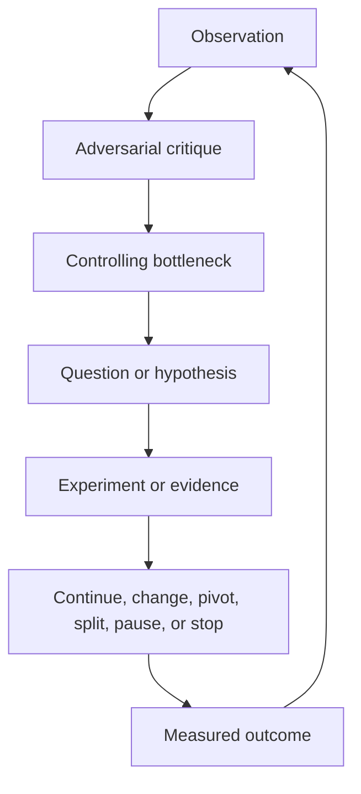

# Self-improvement and adversarial governance

Scrutable improves by running a governed learning loop over evidence. It
does not improve merely because an LLM rewrites text, produces more questions, or
agrees with its previous output.

The governing principle is:

> No praise, criticism, pivot, or framework change counts as learning until it is
> connected to a falsifiable claim, evidence, a decision, and a measured outcome.

This document defines the target mechanism. The repository still needs an executable
engine before the loop can run automatically.

## What can improve

| Level | Subject of improvement | Typical input | Output | Approval authority |
|---|---|---|---|---|
| Application | A built or operating product/system | tests, telemetry, incidents, user outcomes, costs | requirement, design, operational, or retirement change | product/system owner |
| Idea | The problem, audience, value proposition, or solution hypothesis | research, experiments, market evidence, alternatives | continue, change implementation, pivot, split, pause, or stop | accountable sponsor |
| Project graph | Project-specific questions, answers, evidence, risks, and decisions | contradictions, stale evidence, blocked decisions, missed risks | reopened nodes, new question instances, revised priorities | project decision owner |
| Repository | Reusable questions, schemas, algorithms, templates, and policies | outcomes from multiple runs, defects, omissions, duplicated work | versioned catalog or framework change proposal | repository maintainer |

These levels must not be silently conflated. A weak application result may invalidate
an answer without proving that the reusable question is defective. A catalog change
must be justified across runs, or by a severe demonstrable omission, and reviewed as a
framework change.

## The improvement graph

Every cycle adds traceable nodes rather than overwriting history:

The cycle record conforms to
[`../schemas/improvement-cycle.schema.json`](../schemas/improvement-cycle.schema.json).
Use [`../templates/improvement-cycle.md`](../templates/improvement-cycle.md) for a
human-readable projection.

## The algorithm

Run one bounded cycle for one explicit decision:

1. **State the objective and boundary.** Record the subject, desired outcome,
   guardrails, time horizon, decision owner, budget, and current graph revision.
2. **Observe reality.** Ingest attributable evidence such as experiments, interviews,
   telemetry, incidents, costs, support data, search/distribution data, and external
   changes. An LLM summary is not primary evidence.
3. **Invalidate affected claims.** Mark dependent answers and decisions stale when
   evidence contradicts them, expires, or changes an upstream assumption.
4. **Generate independent attacks.** Ask isolated critic roles to produce the strongest
   causal failure cases before they see one another's conclusions.
5. **Build challenge packets.** Each consequential attack must identify a target claim,
   counterclaim, failure mode, causal mechanism, evidence for and against it,
   uncertainty, falsifier, cheapest discriminating test, and decision impact.
6. **Find the controlling bottleneck.** Rank uncertainties and constraints by their
   ability to block the largest amount of downstream value, not by how interesting or
   easy they are to discuss.
7. **Generate missing questions and alternatives.** Create project-specific questions
   for uncovered failure mechanisms. Produce at least the current path, one materially
   different alternative, and stop/pause when the decision is consequential.
8. **Choose the cheapest discriminating test.** Prefer evidence that can make two
   candidate paths predict different observable results. Do not select experiments
   that can only confirm the favored idea.
9. **Cross-examine the result.** The evidence auditor checks provenance and strength;
   critics attempt to refute the interpretation; the decision owner resolves the
   remaining disagreement.
10. **Decide and propagate.** Record `continue`, `implementation_change`,
    `solution_pivot`, `customer_pivot`, `problem_pivot`, `domain_pivot`, `split`,
    `pause`, or `stop`. Reopen every dependent node and regenerate affected artifacts.
11. **Measure the decision.** At the review trigger, compare predicted outcomes with
    observed outcomes. Record error, side effects, and whether the bottleneck moved.
12. **Improve the framework cautiously.** Propose catalog changes when a question
    repeatedly changes decisions, repeatedly wastes effort, or a material concern was
    missed. Validate and review the proposal before publication.

The loop ends at a decision, a declared budget/time bound, or a convergence condition.
It must never continue indefinitely merely to produce more text.

## Bottleneck of bottlenecks

The controlling bottleneck is the unresolved node whose resolution most changes the
probability of achieving the desired outcome across the dependency graph. Use a
normalized score as a ranking aid:

\[
B = \frac{(I \cdot D \cdot U \cdot W \cdot R \cdot T)^{1/6}}
{C + \epsilon}
\]

where:

- \(I\) is consequence impact;
- \(D\) is downstream dependency centrality or blast radius;
- \(U\) is uncertainty;
- \(W\) is evidence weakness;
- \(R\) is irreversibility;
- \(T\) is time urgency;
- \(C\) is validation cost.

Scores prioritize review; they never replace blocker rules or accountable judgment.
A lower-scoring privacy, safety, legal, or catastrophic-loss concern can still block
progress.

## Adversarial agents without performative aggression

"Brutal" means unflinching about evidence and consequences. It does not mean rude,
humiliating, theatrical, or certain without evidence. Attack claims, causal models,
plans, and incentives—not people.

| Role | Required contribution | Forbidden shortcut |
|---|---|---|
| Champion | Strongest evidence-based case for the proposal | enthusiasm presented as evidence |
| User/market critic | Why intended users will ignore, reject, abandon, or distrust it | invented user opinions |
| Technical/operations critic | Feasibility, integration, scale, reliability, and support failures | architecture fashion arguments |
| Security/safety/ethics critic | Abuse, harm, power, privacy, and unacceptable-loss paths | generic risk lists without mechanisms |
| Distribution critic | Discovery, positioning, channel, acquisition, retention, and platform dependence | treating impressions as success |
| Finance/strategy critic | runway, unit economics, opportunity cost, competition, and exit | hiding assumptions inside a score |
| Evidence auditor | provenance, freshness, representativeness, leakage, and alternative explanations | accepting agent agreement as corroboration |
| Decision owner | resolves tradeoffs, accepts risk, and owns the outcome | majority vote among agents |

Use independent first passes to reduce anchoring, then cross-examination. Agent
consensus is not evidence: several agents can repeat the same training bias or prompt
assumption. Preserve minority objections and require the decision owner to address
critical ones explicitly.

### Challenge packet contract

Every high-impact critique must contain:

- target claim and its owner;
- strongest counterclaim, stated so it could be true;
- concrete failure mode and causal mechanism;
- exposed users, assets, obligations, and downstream nodes;
- evidence supporting and opposing the critique;
- likelihood, impact, confidence, and important unknowns;
- observation that would falsify the critique;
- cheapest safe test that distinguishes the competing claims;
- continue/pivot/stop threshold and deadline;
- resulting question, risk, experiment, or decision link.

Reject criticism that is only a harsh adjective, a hypothetical with no plausible
mechanism, or an unfalsifiable assertion. Use the
[`adversarial review template`](../templates/adversarial-review.md).

## Anti-sycophancy rules for LLMs and agents

1. Do not call an idea good, innovative, feasible, or wanted without cited evidence and
   a qualified scope.
2. Ask first: *What would have to be true? What is the strongest reason it is false?*
3. Always expose the top three failure mechanisms and the current controlling
   bottleneck before recommending commitment.
4. Separate facts, observations, inferences, assumptions, predictions, and preferences.
5. Attach a falsifier and kill/pivot criterion to every high-impact prediction.
6. Require alternatives, including doing nothing; ignore sunk cost when comparing them.
7. Calibrate confidence and preserve dissent. Agreement among agents is not an
   independent source.
8. Never fabricate research, customers, metrics, tests, citations, or operational
   evidence. Mark missing access as a blocker.
9. Do not optimize for the founder's emotional approval, the number of questions
   answered, or a high readiness score.
10. A recommendation must state who bears the downside if it is wrong.

## Can an HPC idea become a gaming application?

Yes, but not by uncontrolled semantic drift. First decompose the HPC proposal into
invariants and mutable hypotheses:

- intended outcome or problem;
- beneficiary and buyer;
- reusable capability or asset;
- constraints and unacceptable losses;
- distribution path and economic model.

An HPC workload scheduler might discover that its valuable capability is GPU capacity
allocation and low-latency orchestration. Evidence could justify an adjacent candidate
for cloud rendering, game-server fleets, simulation, or cloud gaming. That is a
testable capability/market pivot.

If the process changes the problem, audience, success measure, and core capability at
the same time, the gaming proposal is a **new subject**, not a revision of the HPC
answer. Create a graph branch, retain a `derived_from` lineage link, and compare both
subjects under the same resource and outcome constraints. Never rewrite the original
history to make the destination look inevitable.

| Pivot class | Preserved | Changed | Required handling |
|---|---|---|---|
| Implementation change | problem, audience, outcome | technology or design | revise affected answers |
| Solution pivot | problem and audience | solution mechanism | branch candidate solution |
| Customer pivot | capability or problem | beneficiary/buyer | re-run user, distribution, legal, and economics questions |
| Problem pivot | capability or audience | problem/outcome | re-run discovery and success definition |
| Domain pivot | little beyond transferable evidence/assets | problem, audience, outcome, market | create a new subject and compare; do not silently mutate |

Novel distance is not evidence of innovation. A far-away idea wins only when evidence
shows a better expected outcome after transition cost, risk, and opportunity cost.

## Attraction, advertising, and visibility

For products whose success requires adoption, usefulness without discovery is a
failure. But attraction alone is also a failure when it reaches the wrong people,
creates no retained value, or costs more than the value it produces.

The system therefore treats the funnel as linked evidence:

> addressable audience -> qualified reach -> attention -> activation -> retained value
> -> referral or expansion -> sustainable economics

Each arrow needs a denominator, time window, segment, source, target, and guardrail.
Vanity impressions cannot compensate for zero retention. Paid advertising must be an
incrementality experiment with a budget limit, acquisition cost, downstream
activation/retention, and stop threshold—not a substitute for product evidence.

The structured catalog includes explicit questions for:

- intended attention and audience fit;
- positioning and message comprehension;
- owned, earned, paid, partner, community, sales, search, marketplace, and integration
  channels;
- funnel conversion and cohort retention;
- advertising incrementality and acquisition economics;
- referrals, sharing, reputation, and trust;
- search-engine, agent, package, marketplace, and platform discoverability;
- channel concentration, policy changes, account loss, and distribution continuity;
- harmful, misleading, addictive, or adversarial attention tactics.

These questions are conditional. A safety-critical internal control system may need
operator adoption and trust, not public attention. Mass visibility can be irrelevant
or harmful. The success definition decides which form of attraction matters.

## Repository self-improvement

The reusable framework learns from outcomes, not from its own prose. Measure at least:

- decision-change rate per question;
- critical-risk discovery rate and severity;
- missed-concern rate found after a gate or incident;
- false-blocker and false-confidence rate;
- duplicated or ambiguous question rate;
- evidence cost and time-to-decision;
- downstream rework associated with weak or missing answers;
- prediction calibration by confidence band;
- question performance across project types, stages, and affected groups.

A repository improvement proposal must include affected stable IDs, supporting run or
incident evidence, expected benefit, compatibility impact, migration, tests, owner,
and reversal trigger. Published IDs are never silently repurposed. New or changed
questions follow `draft -> reviewed -> published -> deprecated`.

The engine may propose a patch; it must not directly rewrite published catalog,
schemas, blocker policies, security controls, or its own approval rules. Those are
protected governance assets.

## Convergence and stopping

An improvement cycle can recommend commitment only when:

- all applicable critical questions are verified or explicitly accepted as risks;
- material contradictions and stale evidence are resolved;
- the controlling bottleneck is validated, mitigated, or consciously accepted;
- the selected candidate beats realistic alternatives under the stated objective;
- success, guardrail, advertising/acquisition where applicable, and kill thresholds
  are measurable;
- ownership and a review trigger exist;
- the iteration budget or evidence target is respected.

The result is a qualified decision, never a guarantee of market or operational success.
The strongest defensible assurance remains: every applicable critical concern is
either supported by accepted evidence or carried as an explicit, owned, reviewable
risk.

