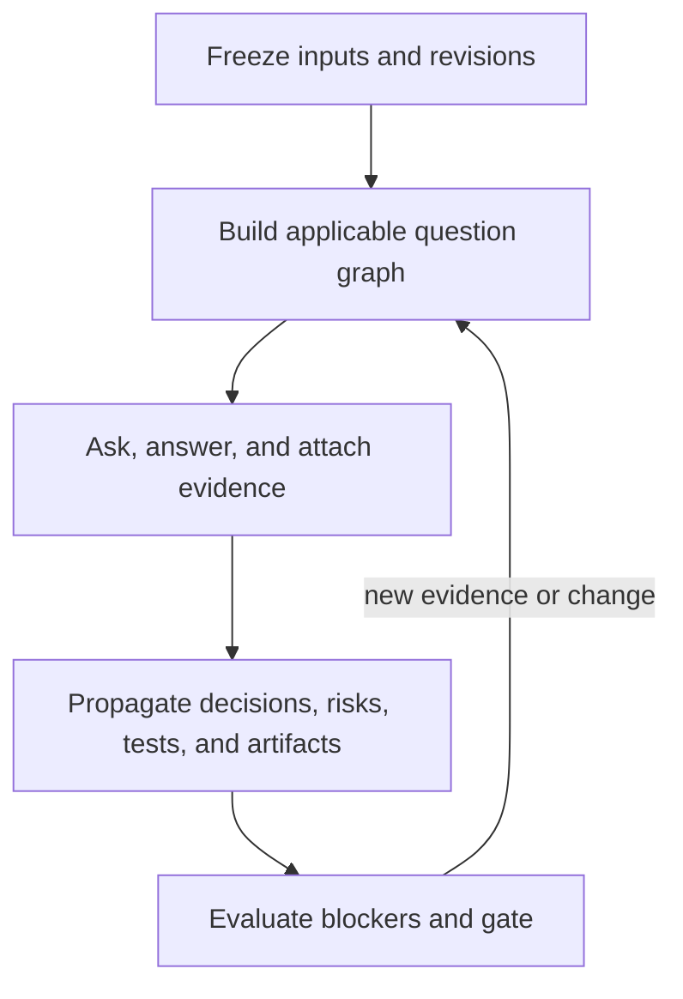

# Usage, project placement, visibility, and agent integration

**Status:** Normative manual protocol and target automation contract; the executable engine is not yet implemented  
**Applies to:** people, coding agents, workflow agents, and future Product Questionbook services

## Direct answer

Product Questionbook is a reusable framework repository, not the default home of every
product reviewed with it. In the recommended arrangement:

- this repository owns reusable questions, schemas, algorithms, policies, templates,
  examples, and framework decisions;
- the target project's repository owns its project profile, answers, evidence links,
  decisions, generated specifications, and run history;
- every target run pins the exact Product Questionbook Git commit it used.

Do not copy a target application's source code into this repository merely to review
it. Do not put confidential project answers into the public framework history. A real
project may use the same repository only when Product Questionbook itself is the
subject, or when an accountable owner deliberately chooses a combined repository.

## Current capability

This repository can be used manually or agent-assisted today. A person or coding
agent can read the catalog, apply the state and evidence rules, and write the output
package. This direct file workflow is the intended primary interface, not a temporary
workaround. The repository does not provide a working `questionbook` CLI, API,
database, graph evaluator, or autonomous application, and none is required for normal
human or agent use. Future commands are optional adapters, not promised prerequisites.

One piece of automation does exist: `tools/validate.py`, a read-only deterministic
conformance validator that runs in CI on every push and pull request
([ADR-0005](../decisions/ADR-0005-deterministic-conformance-validator.md)). It checks
the repository's own structural integrity — schemas, stable IDs, relationship targets,
acyclicity, coverage-manifest fidelity, and Markdown links. It is required for changes
to the framework and irrelevant to running an assessment against a target project. It
owns no canonical state and rewrites nothing.

## Recommended workspace

Keep the framework and target project beside one another. The target project remains
the source of truth for its own run artifacts.

~~~text
workspace/
  product-questionbook/          # clone of MSKazemi/mohsen; read-only during a run
  target-product/                # the application, service, framework, or idea being reviewed
    runs/
      RUN-2026-0001/
        00-manifest.md
        01-context-and-success.md
        02-applicability-and-coverage.md
        03-question-answer-ledger.md
        04-brainstorm-candidates.md
        05-system-brief.md
        06-specification.md
        decisions/
        07-risks-experiments-and-actions.md
        08-verification-and-evidence.md
        09-gate-and-assurance-report.md
        10-audit-and-change-impact.md
        graph.json
~~~

Clone only `main` when a single local framework branch is desired:

~~~bash
git clone --branch main --single-branch git@github.com:MSKazemi/mohsen.git product-questionbook
~~~

For reproducibility, record the resulting commit SHA in `questionbook_ref`. A Git
submodule or vendored snapshot is optional; an adjacent clone plus a pinned SHA is
simpler while the framework is documentation-first. Use a separate private assurance
repository only when permissions, confidentiality, regulation, or cross-repository
governance require it. In that case, record both target and Questionbook revisions.

## Inputs

Every run accepts the same input envelope while allowing subject-specific detail.
Missing information is recorded as `unknown`; it is never invented.

| Input group | Required minimum |
|---|---|
| Run | run ID, purpose, decision to enable, owner, time and evidence budget |
| Subject | stable subject ID, type, boundary, lifecycle stage, target repository and revision |
| Outcomes | beneficiaries, problem or desired outcome, success, failure, and guardrail measures |
| Constraints | time, funding, team, technology, integration, legal, ethical, safety, and operational limits |
| Policies | applicability rules, evidence thresholds, blocker rules, approval authorities, and risk tolerance |
| Evidence | attributable source, observation, collection time, scope, quality, confidence, and expiry |
| Prior state | previous answers, decisions, experiments, incidents, metrics, accepted risks, and open actions |

Start with [`../catalog/core/project-profile.yaml`](../catalog/core/project-profile.yaml)
and the run-manifest template. Add only the domain inputs activated by the subject and
its answers.

## Stable output envelope, conditional content

Different projects should not invent incompatible output contracts. The directory,
identities, trace links, state values, and gate semantics remain stable. The questions,
evidence depth, generated domain sections, and approval requirements vary by subject,
stage, impact, and policy.

At minimum, every run contains a manifest, context and success definition,
applicability/coverage report, question-answer-evidence ledger, gate result, and audit
trace. A simple internal tool may mark public-distribution or robotics sections not
applicable with reasons. A regulated or safety-critical system may add detailed
security, privacy, legal, safety, and operational projections. `Not applicable` is a
recorded conclusion, not permission to silently omit a concern.

## Manual and agent-assisted algorithm

1. Create a run manifest and freeze the target and Questionbook revisions.
2. Instantiate the ten core project-profile questions.
3. Evaluate activation and applicability rules; never ask the entire catalog blindly.
4. Rank the ready frontier by critical blockers, harm, uncertainty, irreversibility,
   dependency centrality, information gain, and cost.
5. Record each response as fact, observation, inference, assumption, prediction,
   preference, or decision. Attach evidence and an owner.
6. Validate dependencies, contradictions, freshness, verification, and approvals.
7. Generate or update requirements, ADRs, risks, experiments, metrics, tests, and
   operating controls from accepted answers.
8. Mark reverse dependants stale when an upstream answer changes.
9. Run the adversarial self-improvement cycle on the controlling bottleneck.
10. Return `proceed`, `proceed_with_conditions`, `pause`, or `stop`, including every
    unresolved condition and accepted risk.
11. At the review trigger, compare predictions with outcomes and begin a new bounded
    epoch for affected nodes.

The full convergence algorithm, including cyclic dependencies and fixed-point
termination, is defined in
[`09-output-convergence-and-implementation.md`](09-output-convergence-and-implementation.md).

## Self-improvement mechanism

Self-improvement is governed error correction, not unrestricted self-editing:

> observe -> challenge -> identify the controlling bottleneck -> form alternatives ->
> run the cheapest discriminating test -> decide -> propagate -> measure prediction
> error -> propose a bounded change

The application, idea, project graph, and reusable framework are separate improvement
levels. A weak project outcome can reopen a project answer without proving that a
published reusable question is wrong. Agents may propose framework patches, but a
maintainer must review changes to published questions, schemas, blocker rules,
security controls, and approval policy. See
[`10-self-improvement-and-adversarial-governance.md`](10-self-improvement-and-adversarial-governance.md).

## Visibility and qualified-attention loop

No framework can guarantee that people, companies, agents, search systems, or news
organizations will provide attention. Their choices and algorithms are external. The
framework can guarantee only that the declared visibility checks were executed, the
evidence and gaps are traceable, and failure thresholds are enforced.

Use this loop when discovery or adoption matters:

1. **Segment the required attention.** Separate intended people, organizational
   buyers and gatekeepers, developers, partners, agents/search systems, communities,
   analysts, journalists, and irrelevant or harmful audiences.
2. **Define a causal funnel.** For every segment and channel measure qualified reach,
   attention, activation, retained value, referral or expansion, and sustainable
   economics with denominators and time windows.
3. **Make positioning falsifiable.** Test whether the segment understands the problem,
   category, promise, distinction, and proof before scaling distribution.
4. **Test discoverability.** Verify indexing, metadata, structured documentation,
   package/marketplace presence, integration paths, agent evaluation, procurement
   requirements, and media evidence packs.
5. **Run bounded experiments.** Give each channel hypothesis a budget, expected
   outcome, holdout or comparison where possible, guardrails, and a stop threshold.
6. **Find the funnel bottleneck.** Prefer the transition whose evidence-backed
   improvement creates the largest downstream retained value, adjusted for uncertainty,
   cost, delay, and risk.
7. **Reallocate or stop.** Continue, change message/product/channel, diversify,
   pause, or stop. Do not scale a channel that creates attention without retained value.
8. **Reopen on change.** Re-run affected questions when ranking systems, platform
   policies, reputation, audience behavior, acquisition cost, procurement, or news
   conditions change.

Background methods include cohort and survival analysis for retention, randomized or
quasi-experimental holdouts for advertising incrementality, Bayesian or sequential
updates for uncertain conversion rates, expected-information-gain prioritization,
dependency-centrality analysis, and constrained channel allocation. These methods
assist a decision; none converts attention into a guaranteed outcome.

The structured questions are:

| Concern | Stable question |
|---|---|
| Required people and harmful attention | `business.attention-audience.001` |
| Understandable and distinct positioning | `business.positioning.001` |
| Owned, earned, paid, partner, community, sales, search, marketplace, and integration channels | `business.channels.001` |
| End-to-end conversion and leakage | `business.funnel.001` |
| Paid advertising incrementality and acquisition economics | `business.advertising.001` |
| Repeated beneficial use | `business.retention.001` |
| Recommendations by people, organizations, platforms, and agents | `business.referral.001` |
| Search, agent, registry, marketplace, and platform discovery | `business.machine-discovery.001` |
| Qualified versus vanity or harmful attention | `business.attention-quality.001` |
| Channel/platform concentration and loss | `business.distribution-risk.001` |
| Journalists, analysts, researchers, communities, and news coverage | `business.earned-media.001` |
| Company gatekeepers, procurement, approval, integration, and renewal | `business.organizational-buying.001` |

## Coding-agent integration

The framework is vendor-neutral. A compatible agent needs repository read/write
access, a way to cite or attach evidence, stable Markdown/YAML/JSON handling, and an
approval boundary. The deterministic rules must remain outside the language model.
That boundary does not require a separate application: a small library, script, or CI
validator can enforce them while the agent continues to read and write canonical text:

| Layer | Responsibility |
|---|---|
| Deterministic core | schema validation, state transitions, dependency propagation, dirty-node queue, blocker policy, gate result, reproducible export |
| Generative adapter | clarify context, propose questions/answers/options, draft artifacts, generate attacks and experiments |
| Evidence adapter | retrieve attributable sources and preserve provenance, permissions, collection time, and freshness |
| Approval adapter | request decisions from authorized owners and record acceptance or rejection |
| Repository adapter | read pinned inputs and write only the authorized run or framework paths with an auditable diff |

Root [`../AGENTS.md`](../AGENTS.md) supplies project instructions for coding agents that
recognize that convention. Root [`../CLAUDE.md`](../CLAUDE.md) is a thin compatibility
adapter for Claude Code-style workflows. Other ChatGPT or agent systems should receive
this document plus [`../templates/agent-run-request.md`](../templates/agent-run-request.md)
as run instructions.

An agent must never:

- manufacture evidence or silently promote an inference to fact;
- edit accepted history instead of appending a revision;
- approve its own consequential recommendation;
- average away a critical blocker;
- modify the reusable catalog merely to make a project pass;
- deploy, contact people, spend money, or command hardware without a separately
  authorized adapter and approval.

## Agent compatibility and optional automation

The text protocol is already usable with Codex, ChatGPT, Claude Code, and other agents
that can read and write repository files. This is protocol compatibility, not proof
that every agent will follow the rules correctly.

The next assurance improvement is a deterministic, read-only-by-default validator with
scenario and property tests. It should be callable by CI and agents and should emit
reviewable reports. A thin CLI may make local invocation easier, but it is optional.
An API, database, autonomous service, or interactive navigator should be built only
after measured requirements justify the extra state, security, migration, and
operational cost.

