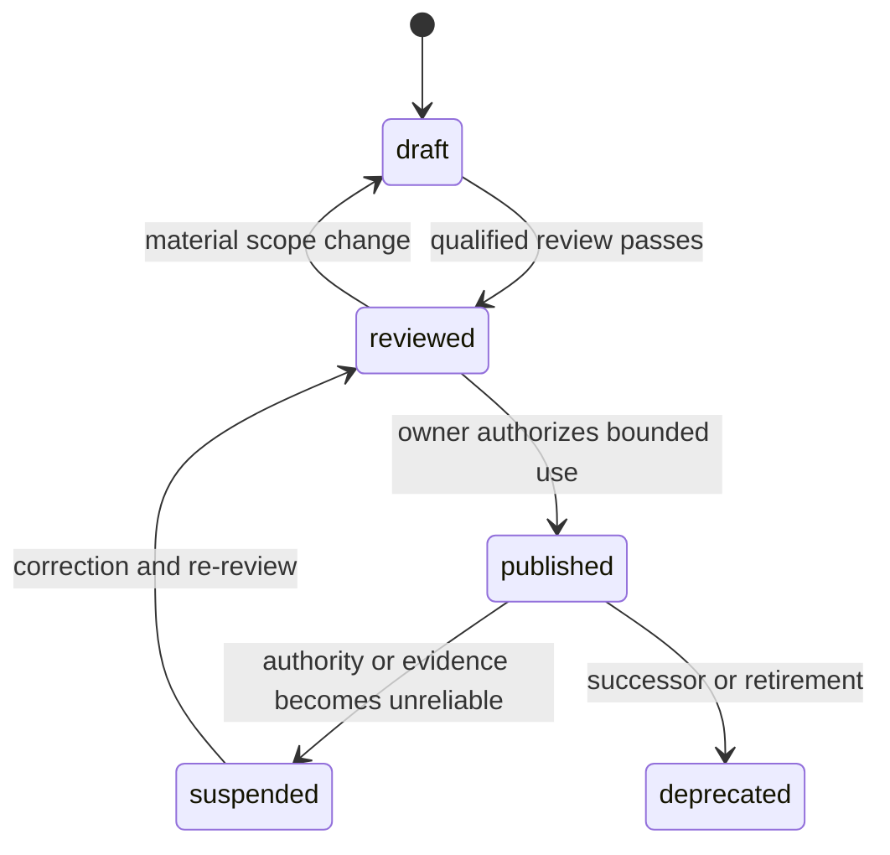

# Domain-pack governance

## Outcome and boundary

A domain pack adds qualified, bounded questions and gate rules that the universal
catalog cannot safely provide. It is a versioned evidence product, not a folder of
prompts and not a substitute for legal, clinical, financial, engineering, or safety
judgment.

The framework now defines how a pack is activated, sourced, reviewed, tested,
published, expired, and propagated. It does not claim that any expert-reviewed pack
currently exists. A draft pack must remain visibly non-authoritative until qualified
reviewers approve its exact scope.

## Required structure

```text
packs/<pack-name>/
  manifest.yaml
  questions.yaml
  README.md
  scenarios/
```

`manifest.yaml` conforms to
[`schemas/domain-pack.schema.json`](../schemas/domain-pack.schema.json). Question
objects conform to [`schemas/question.schema.json`](../schemas/question.schema.json).
Use the [draft manifest](../templates/domain-pack-manifest.yaml) as the starting point.

Pack questions continue to use the universal concern domains such as `legal`,
`quality`, `security`, or `operations`. The pack bundles them and constrains their
applicability; it does not create an ungoverned replacement domain vocabulary.

## Activation decision

Every run starts with [`core.domain-pack.001`](../catalog/core/domain-pack-governance-questions.yaml).
The owner records one of four outcomes:

| Outcome | Meaning | Gate effect |
|---|---|---|
| not required | Evidence shows no listed activation condition applies | Continue; retain rationale and revisit triggers |
| possibly required | Classification, jurisdiction, or harm is uncertain | `pause` until a qualified classifier resolves it |
| required and available | A published, in-scope, non-expired pack exists | Load its questions and blocker policy |
| required but unavailable | No suitable approved pack exists | `pause` or `stop`; generic coverage cannot substitute |

Activation must consider the subject and intended uses, affected populations,
jurisdictions, harm severity, deployment environment, operator qualifications, and
whether a component changes a regulated decision or safety function. When reasonable
classifications disagree, preserve both interpretations and require a qualified
decision owner.

## Authority and provenance

For each external authority, record:

- publisher, source type, stable URI, jurisdiction, version, and named sections;
- effective, checked, and expiry dates;
- the qualified role accountable for interpretation;
- conflicts with other authorities and the resolution or escalation decision.

Search results, model memory, vendor marketing, and unattributed summaries are not
authoritative sources. They may locate evidence, but the reviewer must inspect the
underlying authority. A source that cannot be verified remains an open gap.

## Expert review

`reviewed` and `published` packs require at least one recorded approval, no open review
gaps, at least one authority, a question set, and positive, negative, and
incident-or-audit scenario evidence. Repository maintainership alone is not a domain
qualification.

Each approval states the reviewer, role, qualification basis, review scope, decision,
conditions, review date, and expiry. The required reviewer set depends on the pack and
can include domain practice, legal or compliance, safety or risk, security, affected
party, and operational roles. Conflicts are escalated; they are never averaged into a
false consensus.

The manifest lifecycle is:



Only `published` packs may support an assurance gate. `reviewed` means the content has
been examined, not that a run may rely on it. `suspended`, `deprecated`, draft,
expired, or out-of-scope packs cannot support `proceed`.

## Blockers, equivalence, and waivers

Each blocker names a stable question, a failure condition, and either `pause` or
`stop`. Its waiver record must explicitly say whether a waiver is permitted, which
roles have authority, what evidence is required, and the maximum duration.

Equivalence is not a wording judgment. A proposed alternative must demonstrate the
same controlled hazard, affected population, operating conditions, evidence quality,
and residual-risk authority. A language model may summarize the comparison but cannot
approve it unless the run separately grants that authority to a qualified human role.

Unknown applicability, missing authority, missing required evidence, expired expert
approval, or an unavailable required pack is a blocker. These conditions cannot be
averaged away by unrelated positive scores.

## Scenario assurance

A pack is tested against:

1. positive scenarios that should pass;
2. negative scenarios that must block;
3. ambiguous jurisdiction and scope scenarios that must escalate;
4. expired-source and expired-approval scenarios;
5. real incidents, audits, recalls, enforcement actions, or equivalent evidence;
6. adversarial attempts to misuse scope, waive blockers, or cite weak sources;
7. regression scenarios for every material correction.

Expected applicability, questions, evidence, and gate result are recorded before the
scenario is evaluated. Missed hazards and false blockers remain visible in the pack's
assurance report.

## Change propagation

The pack manifest defines review intervals and revalidation triggers. A changed law,
standard, official interpretation, incident pattern, deployment scope, question,
blocker, reviewer approval, or evidence source triggers materiality review.

The pack owner identifies runs pinned to affected versions and applies the manifest's
policy: notify, reopen, reopen if material, or retire. Reopening preserves the old
decision and evidence history; it creates a new review state rather than rewriting the
past.

## Publication checklist

A pack may move to `published` only when:

1. scope, exclusions, jurisdictions, uses, and risk classes are bounded;
2. activation conditions have positive, negative, and ambiguous examples;
3. authority metadata and interpretations are current and reviewable;
4. questions have stable IDs, complete evidence and output fields, and valid graph
   relationships;
5. blockers, equivalence rules, waivers, and risk-acceptance authorities are explicit;
6. required qualified roles approve the exact pack version and scope;
7. scenario evidence demonstrates important failures are detected;
8. limitations and residual risks are visible;
9. expiry, revalidation, and affected-run behavior are defined;
10. schemas, references, links, catalog counts, coverage status, and changelog are
    updated together.

Until all ten conditions pass, the pack remains draft or reviewed and the repository
must continue to report zero expert-reviewed published packs.
