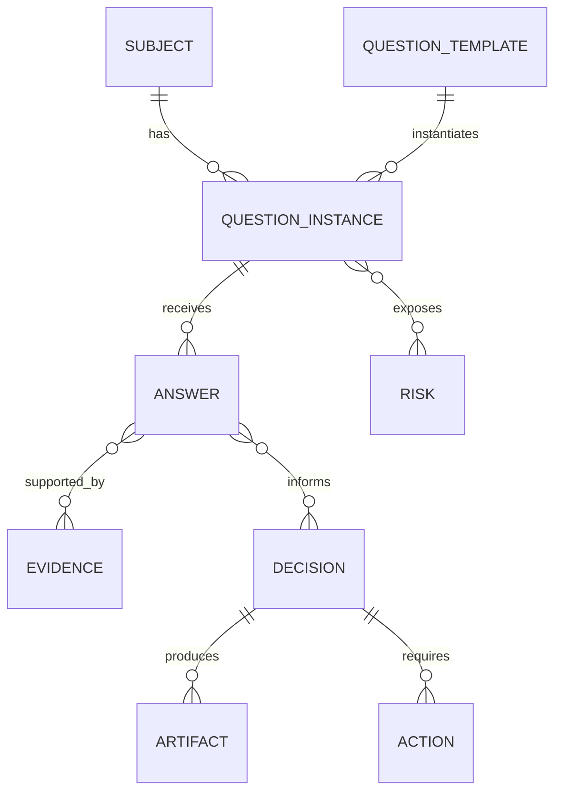

# Domain model

Versioned Markdown and YAML records are canonical state. The graph is the logical
relationship model derived from those records. A `graph.json` file, database,
table, matrix, backlog, or report is a reproducible projection or view and must not
become a silent second source of truth.

## Entity responsibilities

| Entity | Stable identity | Project-specific | Historical |
|---|---:|---:|---:|
| Subject | Yes | Yes | Yes |
| Question template | Yes | No | Publication versions |
| Question instance | Yes | Yes | State transitions |
| Answer | Yes | Yes | Revisions retained |
| Evidence | Yes | Usually | Validity and expiry retained |
| Decision | Yes | Yes | Supersession retained |
| Risk | Yes | Yes | Status history retained |
| Artifact | Yes | Yes | Generated versions retained |
| Action | Yes | Yes | Status history retained |

## Relationship types

The logical graph may use the following relationship types:

- `depends_on`: another answer is needed before this question is ready;
- `refines`: this question makes another answer more precise;
- `activates`: an answer can make another question applicable;
- `contradicts`: the answers cannot both be accepted without reconciliation;
- `related_to`: relevant but non-blocking association;
- `validated_by`: evidence type capable of supporting the answer;
- `mitigates_risk`: risk reduced by resolving the question;
- `produces_artifact`: expected human- or machine-readable output;
- `answered_by_role`: accountable or informed role;
- `revisit_when`: event or expiry condition that can make the answer stale.

Relationship records conform to [`schemas/relationship.schema.json`](../schemas/relationship.schema.json).

The current catalog embeds only question-to-question `depends_on`, `refines`,
`activates`, and `related_to` lists directly in question templates. Evidence
expectations, output expectations, answerer roles, and revisit triggers are authored
as semantic fields on those templates. Other edge types belong in run-specific typed
relationship records until a richer authoring contract is published.

## Invariants

1. A question instance references exactly one template and one subject.
2. Project answers, owners, and states never modify the reusable template.
3. Every state transition is append-only in history even when current state changes.
4. Evidence records identify source, collection time, validity, and reviewer when accepted.
5. Important decisions link to at least one answer and one accountable owner.
6. `not_applicable` requires a recorded reason and the rule or decision that supports it.
7. Accepted critical risks include an owner, rationale, review date, and acceptance authority.
