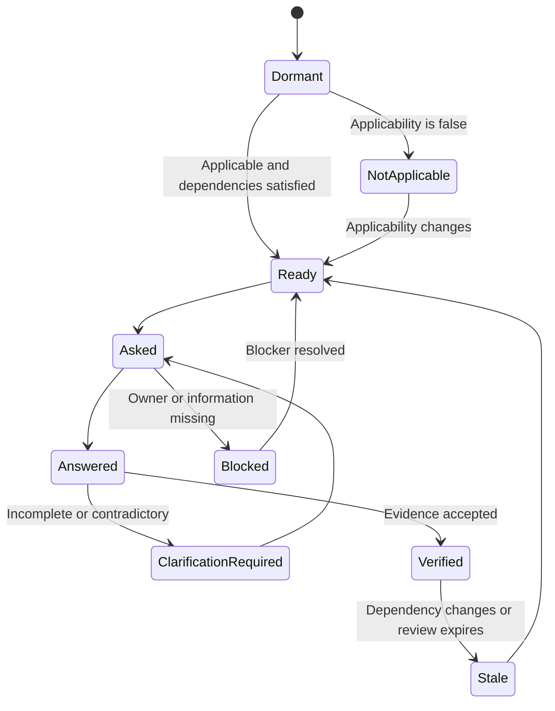

# Question lifecycle

Question templates and question instances have separate lifecycles.

## Instance state machine



| State | Meaning | Exit requirement |
|---|---|---|
| `dormant` | Not yet applicable or dependencies are unresolved | Applicability true and dependencies ready |
| `ready` | Applicable and eligible to ask | Question presented to an owner |
| `asked` | Awaiting an answer | Answer received or blocker recorded |
| `answered` | A response exists but is not yet accepted as supported | Evidence review or clarification |
| `clarification_required` | Answer is incomplete, ambiguous, or contradictory | Revised answer or explicit decision |
| `blocked` | Missing owner, information, authority, or prerequisite | Blocker resolved |
| `verified` | Required evidence has been accepted | Staleness event or material change |
| `stale` | Previous answer can no longer be relied upon | Re-evaluation begins |
| `not_applicable` | Justifiably outside the subject boundary | Applicability changes |

`verified` is not permanent. Review dates and dependency changes can return an
instance to `stale`, then `ready`.

## Template publication lifecycle

```text
draft -> reviewed -> published -> deprecated
```

- `draft`: still being shaped; IDs should not yet be depended upon externally.
- `reviewed`: wording, relationships, evidence, and criticality have been checked.
- `published`: available for project instantiation.
- `deprecated`: retained for history but not used for new instances; a successor may be linked.

## Transition record

Every instance transition records the previous state, new state, actor, timestamp,
reason, and triggering answer, decision, event, or rule. Reconstructing past readiness
must not depend on the current value alone.

