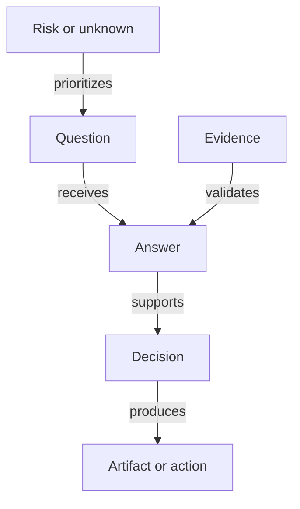

# Structured graph foundation

This foundation turns Product Questionbook into a structured question graph. It asks
what a team does not yet know it needs to ask, connects the answer to evidence
and decisions, and generates the material required to design, build, operate, and
evaluate a system.

## Assurance promise

No question system can guarantee market, technical, or organizational success.
Product Questionbook makes a narrower promise that can be tested:

> Every applicable critical concern is either supported by accepted evidence or
> explicitly recorded as an accepted risk with an owner and review date.

## Four representations

| Representation | Purpose |
|---|---|
| Graph | Canonical relationships among questions, answers, evidence, risks, and decisions |
| State machine | Lifecycle of each question for a particular project |
| Coverage matrix | Gaps across lifecycle stages and concern domains |
| Prioritized backlog | The best questions to answer next |

The matrix and backlog are generated from the graph; they are not separate sources of truth.

The canonical traceability chain is:

> Question -> Answer -> Evidence -> Decision -> Requirement or Action -> Test -> Owner

## Start the adaptive interview

Begin with [`catalog/core/project-profile.yaml`](../catalog/core/project-profile.yaml).
Its ten questions establish subject boundary, affected parties, intended outcome,
success and failure measures, lifecycle stage, constraints, assumptions, available
evidence, and ownership. Answers activate only the relevant domain questions.

The selection engine then:

1. evaluates applicability;
2. keeps unmet dependencies dormant;
3. detects contradictions and missing or stale evidence;
4. ranks ready questions by impact, uncertainty, unlock value, urgency, and answer cost;
5. re-evaluates the graph after every answer or material event.

## Repository components

- [`docs/domain-model.md`](domain-model.md) defines entities, relationships, and invariants.
- [`docs/question-state-machine.md`](question-state-machine.md) defines template and instance lifecycles.
- [`docs/prioritization.md`](prioritization.md) defines adaptive selection and overrides.
- [`docs/coverage-model.md`](coverage-model.md) defines lifecycle-by-domain coverage.
- [`docs/output-contract.md`](output-contract.md) defines the assurance package.
- [`docs/assurance-rules.md`](assurance-rules.md) defines honest completion criteria.
- [`schemas/`](../schemas/) contains machine-readable contracts.
- [`catalog/`](../catalog/) contains reusable templates, never project answers.
- [`examples/sample-application/`](../examples/sample-application/) demonstrates project-specific state.

Markdown remains the human explanation format. YAML holds the authorable structured
catalog. JSON Schema defines validation. Explicit IDs and relationship lists are
sufficient for the first implementation; a specialized graph database should be
introduced only when real query patterns justify it.
